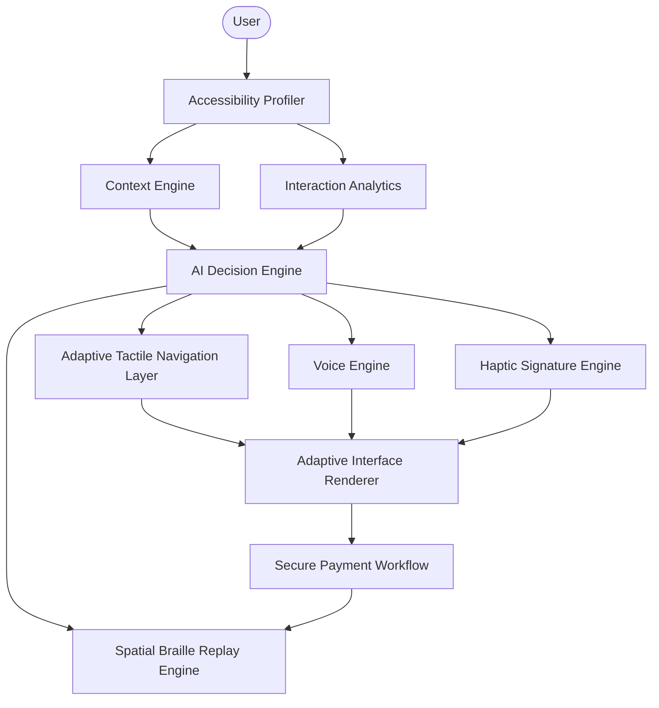

<div align="center">
  <h1>🌟 EchoTouch</h1>
  <h3>Digital payments that adapt to every ability, without relying on sight, sound, or assistance.</h3>
  <p><em>The first mobile payment system where a Deaf-Blind person can independently send money using a virtual Braille keyboard, verify input through haptic signatures, and confirm a transaction — entirely through touch.</em></p>

  <br/>

  
  
  
  
  
  
</div>

---

## 🎯 The Problem

> **Over 2.2 billion people** worldwide have a visual impairment. **Over 430 million** have disabling hearing loss. Yet every major payment app — GPay, Venmo, PayPal — assumes users can see and hear.

Screen readers are the current workaround, but they:

- 🔊 **Read PIN digits aloud** → destroying acoustic privacy
- 📷 **Cannot guide QR scanning** → Blind users can't align a camera
- 🧏‍♂️ **Are useless for Deaf-Blind users** → who can't hear the narration

**No existing solution lets a Deaf-Blind person independently verify a payment recipient, enter a secure PIN, and confirm a transaction.**

---

## ⚡ What EchoTouch Does — In 30 Seconds

EchoTouch is **not** a screen-reader wrapper. It is an adaptive payment system that **physically restructures its entire interface** based on the user's disability profile:

| User Profile   | UI Layout                    | Navigation               | PIN Entry            | Feedback        |
| -------------- | ---------------------------- | ------------------------ | -------------------- | --------------- |
| **Sighted**    | Glassmorphic cards           | Standard taps            | Numeric keypad       | Visual + haptic |
| **Blind**      | Simplified, voice-guided     | Swipe gestures (ATNL)    | V-Braille keyboard   | Voice + haptic  |
| **Deaf-Blind** | Massive tactile zones        | Swipe gestures (ATNL)    | V-Braille keyboard   | Haptic only     |
| **Elderly**    | 4 huge high-contrast buttons | Long-press (tremor-safe) | Large numeric keypad | Gentle haptic   |

The app doesn't just style things differently — it **renders entirely different JSX trees** per profile. Audio buttons vanish for Deaf-Blind users. Standard tapping is disabled for Blind users. The DOM itself adapts.

---

## 🏗️ Tech Stack

| Layer              | Technologies                                                                                                                     |
| ------------------ | -------------------------------------------------------------------------------------------------------------------------------- |
| **Frontend**       | React Native 0.81.5, Expo SDK 54, expo-router, Redux Toolkit, NativeWind                                                         |
| **Backend**        | Spring Boot 3.2.4, Java 17, PostgreSQL 15, Redis 7, Flyway 10.10                                                                 |
| **Security**       | Spring Security 6, BCrypt, JWT (jjwt 0.12.5), HMAC-SHA256 signature verification                                                 |
| **AI / ML**        | Groq API → LLaMA 3.1 8B (intent extraction, tone analysis, toxicity de-escalation), Whisper Large v3 (live speech transcription) |
| **Payments**       | Razorpay REST API (order creation + HMAC-SHA256 cryptographic verification)                                                      |
| **Infrastructure** | Docker Compose (Postgres, Redis, Prometheus, Grafana), ngrok, Render                                                             |
| **Device APIs**    | expo-haptics, expo-speech, expo-camera, expo-secure-store, expo-local-authentication                                             |
| **Observability**  | Micrometer + Prometheus + Grafana, Spring Actuator                                                                               |

---

## 🏆 Top 5 Innovations

### 1. Invisible V-Braille Overlay with Two-Phase Haptic Verification

The touchscreen becomes an invisible 6-dot Braille keyboard. Dots 1–3 map to the **left edge** (top/middle/bottom), Dots 4–6 to the **right edge**. Users double-tap edges to toggle dots, then:

- **Swipe Right (Phase 1):** The device plays back the Braille pattern as haptic vibrations — each row at a distinct intensity (Row 1 = light click, Row 2 = medium bump, Row 3 = deep rumble)
- **Swipe Right (Phase 2):** Commits the digit
- **Swipe Left:** Cancel / delete

This lets users physically **"feel"** their input before submitting — preserving absolute acoustic privacy.

### 2. Adaptive Tactile Navigation Layer (ATNL) with Spatial Collision Detection

Every UI element's screen geometry `(x, y, width, height)` is dynamically measured at runtime. As a user drags their finger across the glass, a **real-time collision detection algorithm** fires a haptic pulse the instant their finger intersects an element's bounding box — letting Blind users build a spatial mental map of the interface.

- **Swipe Right/Left:** Move focus between elements
- **Double Tap:** Activate the focused element
- **Long Press:** Hear/feel a description of the element

### 3. EmoAssist — AI Emotional Shield for Deaf Users

A multimodal perception pipeline for Deaf and Hard of Hearing users:

1. **Live audio transcription** via Whisper Large v3
2. **Emotional tone classification** (Joy, Urgency, Frustration, Neutral) via LLaMA 3.1
3. **Toxicity de-escalation** — aggressive speech is rewritten into calm, actionable summaries
4. **Haptic emotion mapping** — each detected emotion fires a matching vibration signature

### 4. Enterprise-Grade Financial Security

- **Server-side BCrypt PIN verification** — Braille PINs are hashed and verified on the Spring Boot backend, never stored in plaintext
- **HMAC-SHA256 Razorpay signature verification** — cryptographic integrity check on every payment gateway response
- **Serializable transaction isolation** + **pessimistic row-level locking** — prevents double-spend race conditions from rapid taps
- **Database audit logging** — every transaction attempt (success or failure) is recorded in `audit_logs`

### 5. Deaf-Blind Auto-Fallback Onboarding

Unlike standard apps, EchoTouch begins with an **Accessibility Profiler**. If the user doesn't touch the screen within 15 seconds, the app triggers a **haptic SOS pulse** and automatically routes them to the V-Braille Login — because a Deaf-Blind user can't see the onboarding screen or hear its instructions. **The app is accessible from the very first second.**

---

## 🔬 All 15 Research Innovations

<details>
<summary><strong>Click to expand full innovation list</strong></summary>

### 6. Navigation State Machine & Active Payment Feedback

The ATNL is governed by a strict, immutable State Machine (`IDLE → NAVIGATION → INPUT → PROCESSING → SUCCESS`).

- **Interaction Blocking:** Gestures and button clicks are instantly ignored, and the UI is visually dimmed when the app is in a `PROCESSING` state.
- **Active Haptic Heartbeat:** While the transaction is pending, a continuous haptic heartbeat pulses every 2 seconds to reassure the user.
- **Success Confirmation:** A unique success haptic melody (Buzz → Pause → Buzz Buzz) triggers on server confirmation.

### 7. Context-Aware Engine

EchoTouch adapts to the environment, not just the user.

- **Airport Context:** High ambient noise detected. Voice is muted, haptics are amplified.
- **Quiet Library Context:** Voice is minimized, gentle haptics are used.
- **Low Battery Context:** Heavy vibrations are disabled to conserve power; 3D audio sonification is used as a fallback.

### 8. AI User Model & Explainable AI (XAI)

The system silently monitors user accuracy and input speed. Once a user achieves "Expert" status (>80% Braille accuracy, <5sec PIN entry), verbose prompts are shortened and haptic replays speed up. A sleek **Explainability Panel** tells the user exactly why (e.g., _"Expert proficiency detected. Voice prompts shortened."_).

### 9. Adaptive Interface Renderer

The UI fundamentally alters its DOM structure based on the profile. For Deaf-Blind users, audio features disappear entirely. Standard buttons morph into massive, screen-wide tactile action zones.

### 10. Haptic Signature Language

Standard "buzzes" are replaced with a tactile language:

- **Processing:** Continuous Heartbeat (`Thump... Thump...`)
- **Success:** Signature Vibration (`Buzz → Pause → Buzz Buzz → Long Buzz`)

### 11. AI Braille Gamification Tutor

A training module that teaches Braille. If the AI detects repeated failures on a specific dot (e.g., Dot 5), it dynamically overrides the random level generator and forces targeted practice. Provides spatial corrections: _"Almost. You entered dots 1 and 4. Number 5 requires dots 1 and 5."_

### 12. Vibro-Audio Maps (VAMs) & Spatial Collision Detection

Every UI element's spatial geometry is dynamically measured via `onLayout`. A global spatial collision detection algorithm in `GestureInterpreter.tsx` triggers haptic feedback the exact millisecond a user's finger "collides" with an object.

### 13. Global Braille SOS (Escape Hatch)

A complete fail-safe for Deaf-Blind users. Triggered by a continuous **2-finger long press**, this gesture overrides all screen states, plays an emergency SOS haptic signal, and instantly warps the user back to the Dashboard.

### 14. Intelligent Interruption Recovery Engine

If a user is interrupted (phone call, app switch, low battery warning), the engine saves progress (Recipient, Amount, Step) to encrypted `SecureStore`. When the user returns, a dynamically generated prompt helps them regain context. **PIN data is aggressively purged and never cached.**

### 15. Context-Aware Dual Braille Keyboard

Standard Braille shares dot patterns between numbers and letters A-J. EchoTouch eliminates this friction with **Semantic Input Fields** — the "Search by Name" field opens in Alphabet Mode, "Search by Phone Number" opens in Numeric Mode, automatically translating inputs without the Number Sign modifier.

### 16. Adaptive Accessible QR Code Scanner

The camera fires continuous haptic pulses and voice instructions to guide alignment:

- "Move right" → Rapid right-sided haptic bursts
- "Move closer" → Aggressive whole-hand rumble
- **Strict Centering Mode** refuses to decode until the code is perfectly centered, guaranteeing independent verification.

### 17. Context-Aware Biometric Security

Combines native biometric hardware (FaceID / Fingerprint) with all backend cryptographic safeguards for a multi-layered authentication flow.

</details>

---

## 🧭 Architecture



### Database Schema

**12 tables** with proper foreign keys, cascading deletes, and version columns:

`users` · `wallets` · `transactions` · `payment_logs` · `audit_logs` · `braille_pins` · `refresh_tokens` · `accessibility_profiles` · `user_settings` · `favorite_contacts` · `recent_contacts` · `notifications` · `gamification_progress` · `user_statistics`

---

## 🧪 How to Test Core Features

> [!WARNING]
> **Physical device required.** The SBRE engine relies on the device's internal haptic motor. It will fail silently in the iOS Simulator or Android Emulator.

<details>
<summary><strong>Test 1: Capability-Based Adaptation (Elderly vs. Blind)</strong></summary>

1. On a fresh install, the app asks onboarding questions ("Can you see?", "Can you hear?").
2. **Select "Elderly":** UI morphs into a Simplified Dashboard with 4 massive, high-contrast buttons. Send Money uses a standard Numeric Keypad.
3. **Select "Blind":** ATNL activates. Standard tapping is disabled. Swipe left/right to navigate, double-tap to activate. PIN screen morphs into the SBRE.
</details>

<details>
<summary><strong>Test 2: Spatial Braille Replay Engine (SBRE) & Edge Taps</strong></summary>

1. Set profile to **Blind** or **Deaf-Blind**.
2. Navigate to **Learn Braille** or **Send Money** (PIN entry).
3. Swipe-navigation is paused. Screen becomes the Invisible V-Braille Overlay.
4. **Test:** Double-tap top-left edge (Dot 1) and middle-right edge (Dot 5) → number '5'.
5. **Feel the Replay:** Swipe right once. Notice the high-pitch click for Row 1 (dot 1) and mid-pitch bump for Row 2 (dot 5).
6. **Commit:** Swipe right again to commit the digit.
</details>

<details>
<summary><strong>Test 3: AI Gamification Tutor (Explainable AI)</strong></summary>

1. Go to **Learn Braille** → select **Level 1**.
2. **Fail on purpose:** Tap the wrong dot 3 times.
3. **Watch the AI Adapt:** The AI overrides the randomizer, forces practice on your weak dot, and an Explainability Panel states: _"Struggle detected on Dot 4. Modifying lesson plan."_
</details>

<details>
<summary><strong>Test 4: Tremor Protection</strong></summary>

1. Open **Settings** → **Custom Configuration** → enable **Tremor Protection**.
2. Try to quickly tap "Send Money." **It ignores you.**
3. Press and hold for 800ms. It activates — protecting against accidental double-charges.
</details>

<details>
<summary><strong>Test 5: Live Audio EmoAssist</strong></summary>

1. Navigate to the **EmoAssist Hub**.
2. Tap **Listen** and speak (e.g., yell _"I am so angry right now!"_).
3. Tap **Stop**. Within a second, the AI transcribes your voice, determines the emotion, and fires the matching haptic signature.
</details>

<details>
<summary><strong>Test 6: Global Braille SOS & Biometrics</strong></summary>

1. Log out → Biometric Authentication auto-triggers (FaceID/Fingerprint).
2. Go deep into a menu (Send Money).
3. Place **2 fingers** on the glass and hold for 2 seconds.
4. SOS vibration fires → app warps back to Dashboard.
</details>

<details>
<summary><strong>Test 7: Accessible Contact Search & Dual Braille Keyboard</strong></summary>

1. Navigate to **Send Money**.
2. Search by Name → Alphabetical Braille Keyboard opens.
3. Switch to Phone Number → Numeric Braille Keyboard opens (auto-mode switch).
</details>

<details>
<summary><strong>Test 8: QR Merchant Verification & Anti-Fraud</strong></summary>

1. Navigate to **Scan QR**.
2. Scan a QR code (or wait 6 seconds for auto-resolve).
3. The app **intercepts** the flow — Sighted users see the merchant name; Deaf-Blind users use SBRE to haptically read it before proceeding.
</details>

<details>
<summary><strong>Test 9: V-Braille QR Guidance (Deaf-Blind)</strong></summary>

1. Set profile to **Deaf-Blind**, open **Scan QR**.
2. Screen goes dark (no audio, no visuals).
3. Drag your thumb across the screen — feel haptic bumps.
4. Rest thumb in the center → feel a **Heavy Landmark Vibration**.
5. Move the phone — directional haptics guide QR alignment.
</details>

<details>
<summary><strong>Test 10: First-Time Secure PIN Registration</strong></summary>

1. Clear app storage (or use fresh emulator).
2. Log in → State machine detects missing PIN → forces **Secure PIN Registration**.
3. Create and confirm a 6-digit PIN → BCrypt hashed before granting dashboard access.
</details>

---

## 🚀 Quick Start

### Prerequisites

- **Java 17+**, **Maven**, **Docker** (for backend)
- **Node.js 18+**, **Expo CLI** (for frontend)
- **Physical iOS/Android device** with Expo Go installed

### 1. Start the Backend

```bash
cd backend
docker-compose up -d          # Start PostgreSQL, Redis, Prometheus, Grafana
mvn spring-boot:run -Dspring-boot.run.profiles=dev
```

Verify: `http://localhost:8080/swagger-ui.html`

### 2. Expose Backend (for mobile access)

```bash
ngrok http 8080
# Copy the https://xxxx.ngrok-free.app URL
```

### 3. Configure & Start Frontend

```bash
cd frontend
# Edit .env → set EXPO_PUBLIC_API_URL=https://xxxx.ngrok-free.app/api/v1/
npx expo start --tunnel
```

### 4. Run on Device

1. Install **Expo Go** on your phone
2. Scan the QR code from the terminal
3. The app builds directly on your device

> [!WARNING]
> **DO NOT USE AN EMULATOR.** Haptic features require physical hardware.

### Troubleshooting

| Issue               | Fix                                                                 |
| ------------------- | ------------------------------------------------------------------- |
| Backend returns 404 | Check `.env` — URL must end in `/api/v1/`                           |
| API not reachable   | ngrok URL may have changed — update `.env` and restart Expo         |
| Expo Tunnel fails   | Run `npx expo start --tunnel --clear` — hackathon Wi-Fi can be slow |

---

## 💡 Inspiration

Digital payment applications use a one-size-fits-all interface. Users with different disabilities are forced to adapt to the application. But what if the application adapted to the user?

We realized that current accessibility solutions are often an afterthought — a screen reader tacked onto a visual interface. We set out to build an inclusive ecosystem from the ground up, where a Deaf-Blind user, a Blind user, and a sighted user could all achieve financial independence securely, without relying on anyone else.

---

<div align="center">
  <p><strong>EchoTouch</strong> — 15 innovations · Full stack · Working prototype</p>
  <p><em>The first payment app a Deaf-Blind person can use alone.</em></p>
</div>
